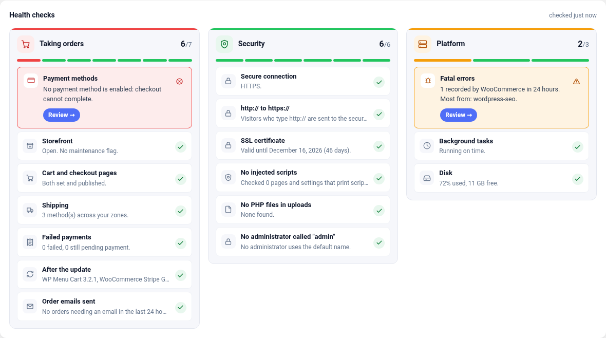

# MageSentinel Monitor — Checkout Monitoring for WooCommerce

Free WordPress plugin that checks the things that quietly break WooCommerce checkout every 15 minutes and emails you when one turns red. No account needed.

- **Install from WordPress.org:** https://wordpress.org/plugins/magesentinel-monitor/
- **Website:** [MageSentinel — WooCommerce checkout monitoring](https://magesentinel.com/woocommerce-checkout-monitoring?utm_source=github&utm_medium=readme)
- **Docs:** https://magesentinel.com/docs
- **Support:** https://magesentinel.com/support

Find out when your WooCommerce store stops taking orders, before your customers tell you.

Every 15 minutes the plugin checks the things that quietly break checkout, and emails you when one turns red:

* no payment method enabled, or one left in test or sandbox mode
* cart or checkout page unpublished or unset
* maintenance mode left on
* a burst of failed payments, or one payment method failing while the others take money
* orders stopped coming in on a store that normally has a steady flow
* SSL certificate close to expiry, slow DNS, a stalled Action Scheduler, WooCommerce fatal errors
* orders that never sent their "New order" email
* card-skimmer scripts injected into pages or settings, PHP files hidden among the uploads, an administrator called "admin"
* Redis or Memcached object cache that stopped answering
* JavaScript errors real shoppers hit on the cart and checkout, and payment scripts that fail to load
* a wave of failed logins, with the usernames bots try and the networks they come from
* wp-config.php, index.php, .htaccess or your theme's checkout templates changed outside an update

Free, no account, and nothing leaves your server. One email per problem, and another when it is fixed.

It comes in two parts. The first one is free and needs no account.

**A health page in your admin.** Under the MageSentinel menu you get a plain reading of the things that quietly stop a WooCommerce store from taking money: whether the cart and checkout pages are still set and published, whether any payment method is enabled at all, whether a shipping zone exists, how many fatal errors WooCommerce logged in the last day, whether Action Scheduler is running on time, whether this server's DNS answers quickly (a slow nameserver makes every payment and courier call wait), and whether a WooCommerce database update is waiting. Each row links straight to the screen that fixes it.

**Email alerts, every 15 minutes.** The same checks run on your site every 15 minutes. When one turns red — no payment method, the checkout page unpublished, maintenance mode left on, a pile of failed payments, or orders that stopped coming in when your store normally has a steady flow — you get an email naming the problem and the screen that fixes it, and another when it is fixed. One email per problem, not one per hour. The email goes out through your site's own mail; nothing else leaves your server. Send it to any address, or switch it off.

**A weekly summary email** (optional, off until you switch it on): every Monday, last week's orders, revenue, average order and failed payments against the week before, with the health checks as they stand. Built from your own orders and sent through your site's own mail.

These checks read your settings and counts from the inside. They cannot tell whether a shopper can actually pay — a broken payment script, a theme update that hides the button. That is what [MageSentinel checkout monitoring](https://magesentinel.com/woocommerce-checkout-monitoring?utm_source=wporg) is for.

**A connector for MageSentinel checkout monitoring** (optional, paid, 14 days free). MageSentinel walks your storefront the way a customer does — finds a product, adds it to the cart, fills the checkout — and tells you when that stops working. This plugin is the part that runs *inside* WordPress, so the check can confirm what actually happened in your database instead of guessing from the page.

The connector is **off by default**. Nothing is exposed until you switch it on and paste a token from your MageSentinel dashboard. Once on, it lets MageSentinel:

* read store health — WordPress, WooCommerce and PHP versions, active plugins, enabled payment and shipping methods, order counts, scheduler state. Never order contents, never customer data;
* confirm the test order a check just placed;
* cancel that test order — only if "Test orders" is switched on, and only for an order from a `magesentinel+` address, under an hour old and unpaid.

**CAPTCHA on your checkout?** MageSentinel never solves or gets around a CAPTCHA. If your checkout asks for one, you can switch on **Let MageSentinel's checks past your CAPTCHA**: requests that carry this store's own connector token are then served without the CAPTCHA, through the CAPTCHA plugin's own allow-list. Every other visitor still gets it. Off by default. Supported: CAPTCHA 4WP (Advanced noCaptcha & invisible Captcha), reCAPTCHA for WooCommerce, hCaptcha for WP and Simple CAPTCHA Alternative with Cloudflare Turnstile.

Test orders never reach anyone's inbox: the plugin silences WooCommerce's new, cancelled, failed, on-hold and customer emails for its own orders.

Once MageSentinel is connected and checking in, it sends your alerts (email or Slack), so the plugin's own emails pause to spare you duplicates. If MageSentinel stops checking in for three hours, they resume on their own.

## Real-browser checkout monitoring

The plugin is the free, on-store half. [MageSentinel](https://magesentinel.com/?utm_source=github&utm_medium=readme) runs a real browser through your checkout around the clock and alerts you the moment a customer can't pay. The Magento 2 module lives at [genetzhs/magento2-monitor](https://github.com/genetzhs/magento2-monitor).

## Development

This repository mirrors the plugin released on WordPress.org (the SVN repository there is the release source). Issues and pull requests are welcome.

## License

GPLv2 or later. See [LICENSE](LICENSE).
